  <picture><source media="(prefers-color-scheme: dark)" srcset="assets/hero-dark.svg"></picture>

  
  
  
  
  

### `> about`

I build **data pipelines that run themselves**: from SAP master data and enterprise migrations to real-time market feeds, landed in **Databricks**, modelled with **PySpark & SQL**, and pushed forward with **frontier LLMs and machine learning**.

- 🏭 **Senior Data Engineer** at **dsm-firmenich**: SAP MDG, migration pipelines and data quality at scale.
- 🧪 **Rigor over hype**: walk-forward validation, pre-registered tests, bootstrap confidence intervals. If there's no edge, the data says so.
- 🤖 **LLM-native development**: agents and models in the loop, from pipeline automation to shipped products.

### `> stack`

  <picture><source media="(prefers-color-scheme: dark)" srcset="assets/stack-dark.svg"></picture>

### `> featured work`

  <a href="https://github.com/yasaiiko/sedecim"><picture><source media="(prefers-color-scheme: dark)" srcset="assets/card-sedecim-dark.svg"></picture></a>
  <a href="https://github.com/yasaiiko/vigil"><picture><source media="(prefers-color-scheme: dark)" srcset="assets/card-vigil-dark.svg"></picture></a>

  <a href="https://github.com/yasaiiko/spain-odds-api-examples"><picture><source media="(prefers-color-scheme: dark)" srcset="assets/card-spain-odds-dark.svg"></picture></a>
  <a href="https://usevetto.com"><picture><source media="(prefers-color-scheme: dark)" srcset="assets/card-vetto-dark.svg"></picture></a>

<b>More</b>

| Project | |
|---|---|
| [supabase-vetto-hook](https://github.com/yasaiiko/supabase-vetto-hook) | Supabase Auth hook that blocks disposable and dead-domain signups |
| [better-auth-vetto](https://github.com/yasaiiko/better-auth-vetto) | Vetto plugin for better-auth |
| [nextjs-vetto-example](https://github.com/yasaiiko/nextjs-vetto-example) | Next.js signup form with Vetto and a Server Action check |
| [disposable-list-audit](https://github.com/yasaiiko/disposable-list-audit) | Weekly audit of disposable-email blocklists for false positives |
| [simucanarias](https://github.com/yasaiiko/simucanarias) | Exam simulator for the Gobierno de Canarias C1/C2 tests |

### `> telemetry`

<!-- cool-readme:start -->

  <picture><source media="(prefers-color-scheme: dark)" srcset="https://raw.githubusercontent.com/yasaiiko/yasaiiko/cards/summary-dark.svg"></picture>
  <picture><source media="(prefers-color-scheme: dark)" srcset="https://raw.githubusercontent.com/yasaiiko/yasaiiko/cards/languages-dark.svg"></picture>

  <picture><source media="(prefers-color-scheme: dark)" srcset="https://raw.githubusercontent.com/yasaiiko/yasaiiko/cards/weekly-dark.svg"></picture>
  <picture><source media="(prefers-color-scheme: dark)" srcset="https://raw.githubusercontent.com/yasaiiko/yasaiiko/cards/streaks-dark.svg"></picture>

<!-- cool-readme:end -->

<code>SELECT insight FROM chaos WHERE rigor = true;</code>

